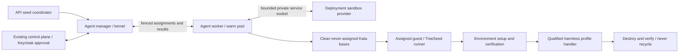

# Agent Capacity Provider architecture

Agent is the host's TreeSeed capacity battery. The manager coordinates authorized activities;
the worker maintains virgin Kata capacity; the guest runner prepares an assigned environment and
executes a harmless qualified handler. Each is a separate service/program with its own native
Cordis root. Deployment's worker does not contain an Agent root.

## Capability map

| Context | Agent-owned selectable capability | Invariant |
| --- | --- | --- |
| Manager | Definition resolver and profile interpreter | Exact definition/schema/provider revisions. |
| Manager | Kernel and team connection adapter | Live authority, lease fencing and result custody remain coherent. |
| Manager | Worker client and admission policy | Bind the actual worker/runner process generation. |
| Worker | Pool policy and sandbox client | Exclusive virgin claim, bounded capacity, background refill. |
| Worker | Runner session and reporting | Retain the selected generation through final cleanup. |
| Guest | Environment preparation and verification | Setup inside the guest before the handler; bounded and cancellable. |
| Guest | Execution, handler, tool and context providers | Harmless admitted probes only until Task 10. |
| Service installation | Manager/worker container and readiness plugins | Agent owns declarations; Deployment installs and supervises. |

SDK supplies portable contracts and native resolver interfaces. Deployment supplies common exact
NPM/Git acquisition, custody and bounded Kata operations. API supplies headless seed coordination
and linked receipts. Identity preserves Keycloak approval and existing signed provider credentials.
CLI selects project/platform profile and invokes public owners; UI supplies reusable rendering.
Platform records exact artifacts and assembled evidence. No cross-checkout source imports.

Profiles have three distinct forms: plugin capability/type, instance inside an Agent definition,
and effective selection bound to exact providers and intersected live authority. Six core type
identifiers are planning, estimating, acting, reviewing, reporting and chat. They are not an
exhaustive enum. An external accepted NPM/Git package can add a type and compatible handler without
editing core catalogues. Unsupported productive selections block until Task 10.

## Sandbox and setup lifecycle

Pool compatibility binds exact runtime/archive/image, resource shape, network/isolation policy
and relevant provider/process generations. Only credential-free, clean, never-assigned guests
enter the pool. Claim removes a base from available inventory before yielding. Worker policy
limits warm and total capacity without a fixed four-sandbox cap. Failed or uncertain resources
are quarantined; they never become available through a retry or saved active flag.

The selected environment package binds explicit immutable setup and verification entrypoints.
Stable dependencies belong in pinned images/archives. Assignment setup runs inside the claimed
guest with bounded time/output, cancellation and least privilege. Offline is the default; each
requested egress destination also needs host policy and live assignment permission. A manifest
declaration alone does not enforce networking. Plugin setup is separate from Kata guest-agent hooks.

The kernel authenticates current authority and fences before dispatch and result publication.
The guest cannot claim host cleanup. Worker completion requires Deployment destruction inspection;
failed destruction is recovery-required. Used guests are destroyed, never recycled. Old generation
unused bases are discarded; in-flight work retains the old providers until verified cleanup.
Worker/sandbox replacement requires explicit restart until that exact transition is qualified.

## Identity, seeds and recovery

Use the existing public team enrollment, signed provider-credential, heartbeat and revocation
protocols through a swappable adapter. Preserve issuer, subject, team, provider, credential and
grant identities exactly. Do not replace team approval with a new client-credentials authority.
Tests use isolated Keycloak and contract fixtures, never production/legacy enrollment.

Seeds compose host capabilities, plugin selections, capacity configuration, Agent definitions and
environments. Profile instances remain inside definitions. API owns the journal and reconciliation;
owners keep resource receipts. Planning validates exact artifacts and prerequisites before state
publication. Apply rechecks authority and owner preconditions, reconciles idempotently and links
verified receipts. Partial, pending and recovery-required remain explicit. There is no cross-owner
atomicity or destructive automatic rollback.

## Evidence and status

The existing unmerged probe root and SDK contract candidates are foundations. They do not prove
working manager/worker services, a real warm pool, enrollment or seed reconciliation. Required
evidence includes actual built programs/default composition, genuine external provider archives,
real Kata claims/setup/refill/destruction, replacement fencing and isolated identity integration.
Hosted Ubuntu KVM/Kata qualification is tracked in Platform #791/#792; self-hosted provisioning
remains an explicit fallback prerequisite. No workstation registration is authorized.

Permanent specifications belong in tests/acceptance, tests/regression, tests/integration and
tests/unit, named for behavior. Fixture support contains no registrations. Every issue remains
open; review candidates target cordis and do not authorize merge, production publication or cutover.
